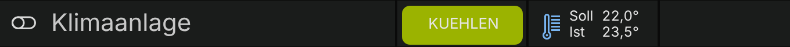
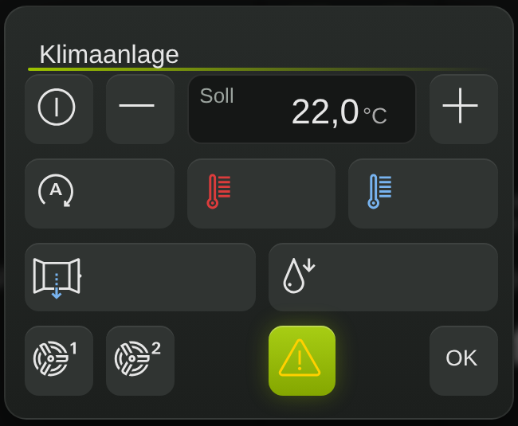
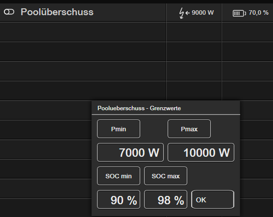
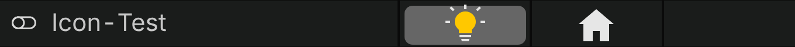

# QC-Funktionsvorlagen

Eigene Funktionsvorlagen (Templates) für den **Gira QuadClient** am Gira HomeServer – nutzbar im
Windows-QuadClient und im [QC-Client](https://github.com/BadSmiley0815/QC-Client) (`qc.html`).

> **Vorlagen-IDs vorläufig:** Eine Vorlagen-ID besteht aus *Entwickler-ID + Nummer* (z. B. `1-101`).
> Die eigene Entwickler-ID ist bei Gira angefragt; bis zur Vergabe verwenden die Vorlagen hier
> die vorläufige Entwickler-ID **99**. Danach werden alle Vorlagen in allen Dateien umgestellt –
> Elemente, die eine 99-Vorlage nutzen, müssen im Experten neu zugewiesen werden.

## Vorlagen

| ID (vorläufig) | Name | Inhalt |
|---|---|---|
| 99-1 | Klimaanlage KLIC-DI | Daikin-Klimaanlage über Zennio KLIC-DI v2: Ein/Aus, Solltemperatur, Betriebsart, 2 Lüfterstufen, Ist-Temperatur, Filter, Fehler |
| 99-2 | Poolüberschuss | PV-Überschuss in W und Speicher-SOC in %, Grenzwerte Pmin/Pmax und SOC min/max einstellbar |
| 99-3 | Icon-Test | Test für eigene Symbole in Vorlagen (Symbolpaket `.hsm`), im Windows-QC bestätigt |

Die fertigen `.hst` in `dist/` sind die getesteten Fassungen. `./tools/build.sh` baut sie aus `src/` neu.

### 99-1 Klimaanlage KLIC-DI

Für eine Daikin-Klimaanlage am Zennio KLIC-DI v2.

- **Zeile:** links Ein/Aus mit Anzeige der Betriebsart, rechts Soll-/Ist-Temperatur; Antippen öffnet das Popup.
- **Popup:** Ein/Aus, Solltemperatur −/+, Betriebsart (Auto, Heizen, Kühlen, Lüften, Trocknen – HVAC-Werte 0/1/3/9/14),
  Lüfterstufe 1/2 (50 % / 100 %), Filter-Reset, Fehleranzeige.
- **Anschlüsse:**

  | Slot | Bezeichnung | Typ | Pflicht |
  |---|---|---|---|
  | `onoff_set` | Ein/Aus (senden) | KO_NUM | ja |
  | `soll_temp_set` | Solltemperatur (senden) | KO_NUM | ja |
  | `mode_set` | Betriebsmodus (senden) | KO_NUM | ja |
  | `fan_set` | Luefterstufe (senden) | KO_NUM | ja |
  | `onoff_status` | Ein/Aus Status | KO_NUM | ja |
  | `soll_temp_status` | Solltemperatur Status | KO_NUM | ja |
  | `ist_temp` | Isttemperatur (Raum) | KO_NUM | ja |
  | `mode_status` | Modus Status | KO_NUM | ja |
  | `fan_status` | Luefterstufe Status | KO_NUM | ja |
  | `error_active` | Stoerung aktiv | KO_NUM | – |
  | `error_code` | Fehlercode | KO_ALPHA | – |
  | `filter_status` | Filter verstopft (Status) | KO_NUM | – |
  | `filter_reset` | Filter Reset (senden) | KO_NUM | – |





*Dargestellt im [QC-Client](https://github.com/BadSmiley0815/QC-Client) mit Beispielwerten.*

### 99-2 Poolüberschuss

Für eine Poolheizung, die nur mit PV-Überschuss laufen soll.

- **Zeile:** aktueller Überschuss in W und Speicher-SOC in % (Batteriesymbol wechselt mit dem Ladestand).
- **Popup:** Grenzwerte Pmin/Pmax (W) und SOC min/max (%) eingeben.
- **Anschlüsse:**

  | Slot | Bezeichnung | Typ | Pflicht |
  |---|---|---|---|
  | `power_max_set` | Obere Leistungsgrenze (W) | KO_NUM | ja |
  | `power_min_set` | Untere Leistungsgrenze (W) | KO_NUM | ja |
  | `soc_max_set` | Oberer SOC-Grenzwert (%) | KO_NUM | ja |
  | `soc_min_set` | Unterer SOC-Grenzwert (%) | KO_NUM | ja |
  | `power_actual` | Aktueller Ueberschuss (W) | KO_NUM | ja |
  | `soc_actual` | Aktueller SOC (%) | KO_NUM | ja |



*Im Windows-QuadClient.*

### 99-3 Icon-Test

Zeigt, wie eine Vorlage eigene Symbole mitbringt: Die Symbole liegen als einfache SVG in `icons/`,
`tools/hsm-build.py` erzeugt daraus das Symbolpaket `99-3.hsm` und packt es in die `.hst`.

- **Zeile:** Taste schaltet ein 1-Bit-KO, das Symbol wechselt Lampe aus/ein; daneben ein festes eigenes Symbol.
- **Anschluss:**

  | Slot | Bezeichnung | Typ | Pflicht |
  |---|---|---|---|
  | `switch` | Schalten | KO_NUM | ja |



## Installation

1. `dist/<ID>_<Name>.hst` herunterladen.
2. Im Experten die Vorlage importieren, Element anlegen, KOs an die Slots hängen, Parameter setzen.
3. Projekt übertragen.

## Aufbau und Bauen

```
<ID>_<Name>/
  src/       version.xml, interface.xml, template.xml, language.xml, config_lang.xml
  icons/     (optional) eigene Symbole als einfache SVG (nur Pfade, 40×40)
  labels.txt (optional) Symbolnamen für die Auswahl im Experten
  *.png      Beispielbilder
dist/        fertige .hst
tools/       hsm-build.py (Symbolpaket .hsm + .hst), build.sh (alle Vorlagen bauen)
```

Bauen: `./tools/build.sh` (benötigt Python 3, `zip` und für eigene Symbole `rsvg-convert`).
Bei jeder Änderung die Version in `src/version.xml` erhöhen.

## Lizenz

GNU General Public License v3.0 – siehe [`LICENSE`](LICENSE). Jeder darf die Vorlagen nutzen,
ändern und weitergeben; geänderte Fassungen müssen ebenfalls unter der GPL-3.0 offen bleiben.
Abwandlungen bitte mit eigener Entwickler-ID und angepasster Vorlagen-ID in allen Dateien veröffentlichen.

## Hinweise

- Unabhängiges Projekt, **nicht von Gira** und nicht von Gira unterstützt. „Gira“,
  „HomeServer“ und „QuadClient“ sind Marken ihrer Inhaber.
- Enthält keine Gira-Symbole oder -Dateien; alle Symbole sind eigene Zeichnungen. Die Vorlagen
  verwenden die Layouts und Standard-Hintergründe, die der QuadClient selbst mitbringt.
- Entwickelt mit Claude (Anthropic).
