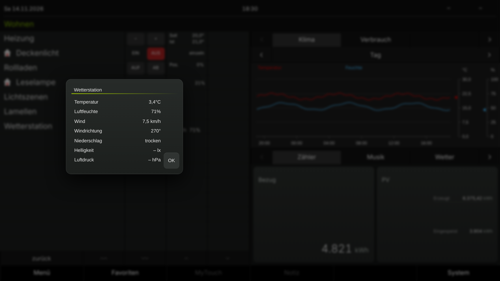

# QC-Funktionsvorlagen

Eigene Funktionsvorlagen (Templates) für den **Gira QuadClient** am Gira HomeServer – nutzbar im
Windows-QuadClient und im [QC-Client](https://github.com/BadSmiley0815/QC-Client) (`qc.html`).

> **Vorlagen-IDs vorläufig:** Eine Vorlagen-ID besteht aus *Entwickler-ID + Nummer* (z. B. `1-101`).
> Die eigene Entwickler-ID ist bei Gira angefragt; bis zur Vergabe verwenden die Vorlagen hier
> die vorläufige Entwickler-ID **99**. Danach werden alle Vorlagen in allen Dateien umgestellt –
> Elemente, die eine 99-Vorlage nutzen, müssen im Experten neu zugewiesen werden.

## Vorlagen

| ID (vorläufig) | Name | Inhalt |
|---|---|---|
| 99-4 | Wetterstation | Werte einer Wetterstation am KNX: Temperatur, Luftfeuchte, Wind, Windrichtung, Regen, Helligkeit, Luftdruck |

### 99-4 Wetterstation

Nur Anzeige, es wird nichts gesendet. Für eigene oder Gira-Wetterstationen, auch für Werte aus einem Logikbaustein.

- **Zeile:** Thermometer + Temperatur · Wind + Geschwindigkeit · Luftfeuchte (Symbol wird bei Regen zur Regenwolke)
- **Antippen:** Popup mit allen Werten
- **Anschlüsse** (Datentyp steht in der Bezeichnung, nur Temperatur ist Pflicht):

  | Slot | Wert | Datentyp |
  |---|---|---|
  | `slot_temp` | Temperatur | 2 Byte Gleitkomma (DPT 9.001) |
  | `slot_hum` | Luftfeuchte | 2 Byte Gleitkomma (9.007) oder 1 Byte (5.001) |
  | `slot_wind` | Windgeschwindigkeit | 2 Byte Gleitkomma (9.005 / 9.028) |
  | `slot_wind_dir` | Windrichtung in Grad, 0 = Nord | 1 Byte Winkel (5.003) oder Zahl |
  | `slot_rain` | Regen, 1 = Regen | 1 Bit (DPT 1.x) |
  | `slot_lux` | Helligkeit | 2 Byte Gleitkomma (9.004) oder 4 Byte |
  | `slot_press` | Luftdruck | 2 Byte Gleitkomma oder 4 Byte |

- **Parameter:** Überschrift des Popups, Einheiten für Wind, Helligkeit und Luftdruck.
- **QC-Client:** Das Wetter-Plugin nimmt die Werte dieser Vorlage für „Jetzt“ (ab v0.9.34), die Vorhersage kommt von Open-Meteo.



## Installation

1. `dist/<ID>_<Name>.hst` herunterladen.
2. Im Experten die Vorlage importieren, Element anlegen, KOs an die Slots hängen, Parameter setzen.
3. Projekt übertragen.

## Aufbau und Bauen

```
<ID>_<Name>/
  src/       version.xml, interface.xml, template.xml, language.xml, config_lang.xml
  icons/     eigene Symbole als einfache SVG (nur Pfade, 40×40)
  labels.txt Symbolnamen für die Auswahl im Experten
dist/        fertige .hst
tools/       hsm-build.py (Symbolpaket .hsm + .hst), build.sh (alle Vorlagen bauen)
```

Bauen: `./tools/build.sh` (benötigt Python 3 und `rsvg-convert`).
Bei jeder Änderung die Version in `src/version.xml` erhöhen.

## Lizenz

GNU General Public License v3.0 – siehe [`LICENSE`](LICENSE). Jeder darf die Vorlagen nutzen,
ändern und weitergeben; geänderte Fassungen müssen ebenfalls unter der GPL-3.0 offen bleiben.
Abwandlungen bitte mit eigener Entwickler-ID und angepasster Vorlagen-ID in allen Dateien veröffentlichen.

## Hinweise

- Unabhängiges Projekt, **nicht von Gira** und nicht von Gira unterstützt. „Gira“,
  „HomeServer“ und „QuadClient“ sind Marken ihrer Inhaber.
- Enthält keine Gira-Symbole oder -Dateien; alle Symbole sind eigene Zeichnungen. Die Vorlagen
  verwenden die Layouts und Standard-Hintergründe, die der QuadClient selbst mitbringt.
- Entwickelt mit Claude (Anthropic).
